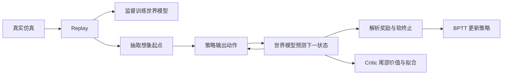

SuperMimic 与本地 allmimic 的代码、网络及参数对照
================================================

本报告基于 2026-11-11 检查时的本地代码和 checkpoint。SuperMimic 提交为 `5efbf114e11f725c31d83e217be987c13c0e4ce2`，allmimic 提交为 `01e6ad299e7db753a7822551dbd58c00548a8c30`。比较对象是这两个工作目录的实际内容，不以 README 对论文或“原版”的描述代替代码判断。

两者共享“真实仿真采集 → replay → 拟合确定性世界模型 → 冻结世界模型参数并通过想象轨迹反传训练策略 → critic 拟合”的主流程。主要区别在状态表示、预测目标、策略观测、目标窗口、损失尺度和工程配置。相同隐藏层宽度并不意味着同一个模型，也不能据此直接加载对方 checkpoint。

SuperMimic 的完整运行仍缺少 `../mjlab_research`；因此本文对它采用源码分析和独立网络构建统计，没有声称完成其训练验证。参数统计在现有 allmimic 虚拟环境的 PyTorch `2.14.1+cu130` 中使用 meta device 构建两方的网络类，以闭式公式交叉核对；读取现有 checkpoint 时使用 `FakeTensorMode + weights_only=True + mmap=True`，没有启动 GPU 仿真或训练。

原始统计与 checkpoint 配置快照见 [参数 JSON](supermimic_vs_allmimic_parameters.json)。

**1. 比较口径与整体结构**

| 比较项 | SuperMimic | allmimic |
|---|---|---|
| 主入口 | `scripts/train.py`，任务注册 + runner | `allmimic.train`，Trainer 组合 Task/Env/Replay |
| 默认机器人 | 已注册 G1 两种状态表示 | G1；另有 EVT 的机器人资产与控制适配 |
| 世界模型 | `Dynamics + StateRepresentation` | `WorldModel + Task + 可微 FK` |
| 策略 | 多个任务 goal encoder，共享 decoder | 主入口一个 motion encoder + decoder；velocity 为单独训练入口 |
| 主训练算法 | 默认 BPTT + critic；可选不带 critic 的 BPTT | 默认 BPTT + critic；`use_critic=False` 可关闭尾部价值 |
| 其他算法 | `train_ppo.py`：PPO 在学习到的模型中训练 | `ppo.py`：真实仿真 PPO；`ppo_wm.py`：模型内 PPO；`adapt.py`：新动作适应 |
| 奖励/终止 | 用解析函数从预测状态计算 | 同样采用解析函数 |
| 多 GPU | 当前主入口没有梯度同步/DDP 实现 | `torchrun`，广播初值、梯度/归一化统计 all-reduce |
| 数据和记录 | W&B Registry 或本地 motion；W&B 记录与模型 artifact | 本地 motion library；JSONL、checkpoint、评估和导出工具 |

主算法的梯度流可概括为：



策略更新时冻结的是世界模型的参数；仍保留动作到预测状态的梯度，否则无法进行 BPTT。两方 encoder 输出 tanh latent，再与观测拼接给 decoder；这里是确定性瓶颈，主路径没有 VAE 的随机后验、KL 损失或重建训练目标。

**2. 世界模型：预测对象和状态表示有根本差异**

以下数值取 29 个关节、33 维基础仿真上下文。SuperMimic 的上下文由实际启用的事件动态决定，33 维对应摩擦 1 + COM 偏移 3 + 编码器偏置 29。MaxCoord 示例取 14 个跟踪 body；该数量应由取得研究依赖后的实际环境确认。

| 项目 | SuperMimic GenCoord | SuperMimic MaxCoord，B=14 | allmimic 默认 / recommended | allmimic root-feedback-delay |
|---|---:|---:|---:|---:|
| 原始状态 | 71 | 182 = 13B | 71 | 71 |
| 神经网络状态特征 | 68 | 214 = 15B+4 | 245 | 245 |
| 动作输入 | 29 | 29 | 29 | 29 |
| 仿真上下文 | 33 | 33 | 33 | 66 |
| 世界模型 MLP 输入 | 130 | 276 | 307 | 340 |
| 隐藏层 | 2048, 2048, 2048 | 相同 | 相同 | 相同 |
| 输出 | 35 | 84 = 6B | 70；可选 tripoint 输出 76 | 默认 70 |
| 隐藏层操作 | Linear + LayerNorm + GELU | 同左 | Linear + SiLU | 同左 |

GenCoord 的 68 维特征为 `[root_height(1), gravity_body(3), linear_velocity_body(3), angular_velocity_body(3), q(29), qd(29)]`。网络只预测 `[Δv_body(3), Δω_body(3), Δqd(29)]`，根位置、四元数、关节角通过解析积分得到。积分系数为 `(decimation+1)/(2*decimation)`，对应均匀加速度下多个半隐式子步的组合；如果 decimation=4，系数为 0.625。高度、重力和速度会随根坐标系更新，而非由不同输出通道各自预测。

MaxCoord 把各跟踪 body 的相对位置、6D 姿态、速度、角速度放进状态，预测每个 body 的线速度/角速度增量，再积分。奖励和 proprio 所需的关节状态通过解析 IK 恢复。它的表示能力、误差传播与 GenCoord 不同，不能将两个 task 当作网络名字不同的同一实验。

allmimic 使用关节空间状态，但输入增加了全部机器人 body 的 FK 位置与线速度。默认 6D 旋转配置下，特征维度为：

```text
1 高度 + 6 根朝向 + 3 根线速度 + 3 根角速度 + 29 q + 29 qd
+ 29 个非根 body × (3 相对位置 + 3 线速度)
= 245
```

因此这里的 30 个全机器人 body 与奖励所用 14 个跟踪 body 是两个数量；不能把 allmimic 的特征误算为 14-body MaxCoord。其 70 维输出是根平移 3、根旋转轴角 3、根线速度 3、根角速度 3、关节角 29、关节速度 29 的增量。位置与速度通道都有学习自由度，不像 GenCoord 强制用速度增量决定姿态积分。默认使用 heading frame 构造特征；SuperMimic GenCoord 使用完整 root body frame。

两种取舍分别是：SuperMimic 将更多运动学关系固定到积分中，减少输出自由度；allmimic 给输入提供更多显式 FK 信息，并直接拟合更完整的状态变化。哪种预测和控制更准确，必须在相同机器人、数据和 rollout 长度下测量。

**3. Actor、Critic 的输入与网络结构**

两方 Actor encoder/decoder 的隐藏层都是 `2048 → 1024 → 512 → 256`，Critic 都是 `256 → 128`。SuperMimic 三类网络使用 LayerNorm + GELU；allmimic Actor/Critic 使用 ELU，世界模型使用 SiLU，没有隐藏层 LayerNorm。allmimic 的策略输出层和世界模型输出层有 gain=0.01 的正交初始化；SuperMimic `build_mlp` 使用 PyTorch Linear 的默认初始化。

| 项目 | SuperMimic GenCoord 默认 | allmimic 默认 | allmimic recommended | allmimic root-feedback-delay |
|---|---:|---:|---:|---:|
| 单帧 Actor 观测 | 68 维 rep_state | 93 维 proprio | 93 | 99 |
| 历史帧 | 1 | 10 | 10 | 10 |
| 展平观测 | 68 | 930 | 930 | 990 |
| motion goal | 640 | 730 | 730 | 730 |
| latent | 32 | 32 | 128 | 128 |
| decoder 输入 | 100 | 962 | 1058 | 1118 |
| 动作输出 | 29 | 29 | 29 | 29 |
| Critic 输入 | 771 | 1009 | 1009 | 1132 |

SuperMimic 默认策略可读取根高度和根线速度等仿真状态，并且 `rep_state` 模式不注入 proprio 噪声。源码支持切换 `actor_obs=proprio`，此时单帧为 93 维；启用多帧历史必须同时使用该模式。例如 history=10 时 decoder 输入变为 `930+32=962`，更接近 allmimic 的历史输入，但 goal、动力学、损失和激活仍然不同。

allmimic 的 93 维为关节相对位置 29、关节速度 29、gyro 3、重力方向 3、上次动作 29。root-feedback 在每帧追加当前机器人相对参考姿态的 6D 表示，得到 99×10=990；Critic 另外增加 10 个未来参考根位姿，每帧位置 3 + 姿态 6，共 90 维。基础 Critic 还包括剩余动作时间 1 维。SuperMimic Critic 为 `rep_state + 完整 wm_goal + sim_ctx`，没有这项剩余时间输入，也没有独立的输入归一化器；allmimic Critic 有输入 Normalizer。

默认 33 维上下文时，Critic 维度公式是：

```text
SuperMimic GenCoord: 68 + 670 + 33 = 771
allmimic base:       245 + 730 + 33 + 1 = 1009
allmimic feedback:  1009 + 90 = 1099
allmimic delay:     1099 + 33 = 1132
```

**4. 参考窗口、坐标系与 6D 排列**

SuperMimic 的窗口是 `[t, t+5, ..., t+45]`，在 50 Hz 下覆盖当前到约 0.9 秒；allmimic 默认窗口为 `[t+1, ..., t+10]`，覆盖 0.02～0.2 秒。allmimic 可通过 `future_offsets` 使用稀疏长窗口，但当前检查的 EVT checkpoint 使用空配置，即连续 1～10 帧。

SuperMimic motion encoder 的 640 维为：10 帧关节角/速度 580，加机器人当前根坐标系下未来参考朝向 60。Critic 的完整 goal 为 670 维，额外包含未来根相对位置 30。allmimic 每帧 73 维，包括参考根位置 3、朝向 6、q/qd 共 58、参考根线速度/角速度共 6，总计 730。默认 `current_ref` 以当前参考位置/heading 构造目标，base goal 本身不直接反映机器人相对参考的误差；root-feedback 通过额外观测补充这种反馈。SuperMimic goal 的未来朝向本来就是相对当前机器人的，不能把两种 feedback 说成完全相同。

还存在容易在移植时被忽略的序列排列差异：

| 编码 | SuperMimic | allmimic |
|---|---|---|
| 6D 旋转的顺序 | `[R00,R01,R10,R11,R20,R21]` | `[R00,R10,R20,R01,R11,R21]` |
| 单位旋转 | `[1,0,0,1,0,0]` | `[1,0,0,0,1,0]` |
| proprio 单帧顺序 | 重力、gyro、q、qd、上次动作 | q、qd、gyro、重力、上次动作 |

即使人为把输入维度改成一样，直接沿用对方的观测拼接和归一化统计也会改变网络语义。

**5. 精确可训练参数量与实际推理路径**

以下计入 Linear 的 weight/bias、LayerNorm 的 weight/bias；归一化 running statistics、固定常量和 optimizer state 不计入。这里的“注册参数”指模型中存在的 Parameter；“motion 路径”排除默认未使用的速度 encoder。SuperMimic 的计数建立在上述上下文维度和 body 数假设上。

| 模型组件 | SuperMimic GenCoord | SuperMimic MaxCoord，B=14 | allmimic 默认 | allmimic recommended | allmimic feedback-delay |
|---|---:|---:|---:|---:|---:|
| 世界模型 | 8,744,995 | 9,144,404 | 9,166,918 | 9,166,918 | 9,234,502 |
| motion encoder | 4,082,976 | 4,082,976 | 4,259,616 | 4,284,288 | 4,284,288 |
| decoder | 2,976,285 | 3,275,293 | 4,733,981 | 4,930,589 | 5,053,469 |
| motion Actor 合计 | 7,059,261 | 7,358,269 | 8,993,597 | 9,214,877 | 9,337,757 |
| Critic | 231,425 | 268,801 | 291,585 | 291,585 | 323,073 |
| motion 路径三模型总量 | 16,035,681 | 16,771,474 | 18,452,100 | 18,673,380 | 18,895,332 |
| 额外注册 velocity encoder | 2,778,400 | 2,778,400 | 主入口无 | 主入口无 | 主入口无 |
| 全部注册总量 | 18,814,081 | 19,549,874 | 18,452,100 | 18,673,380 | 18,895,332 |

计数公式可独立复核：`Linear(a,b)=a*b+b`；SuperMimic 每个隐藏层另加 `LayerNorm(b)=2*b`。

SuperMimic 默认 `slot_mix={motion:1.0, velocity:0.0}`，但 `resolve_task_specs` 仍返回两个任务并创建两个 encoder。速度 encoder 占约 278 万参数；默认没有数据槽位进入它，也没有对应 latent BC 训练，不能把它视为已训练的速度控制能力。正常 motion 推理只需 motion encoder 和 decoder，世界模型、Critic 也不属于部署 Actor。

allmimic 的 latent 从 32 扩到 128，只让整个 Actor 增加 221,280 个参数，约 2.46%，并不是参数量增为四倍；主体参数仍在大隐藏层。root-feedback 使 Actor 再增加 122,880 个参数。delay 只扩展 WM/Critic 输入，在 root-feedback 基础上共增加 76,032 个参数，不改变 Actor 的输入/输出形状。

若将 SuperMimic 改为 GenCoord + proprio + history10，motion Actor 为 8,824,637 参数；包含默认 velocity encoder 的所有模型共 20,579,457 参数。这个例子说明两个仓库原始默认 Actor 规模差异很大一部分来自历史输入宽度。

只统计 Linear 权重乘法的单样本前向 MAC：SuperMimic GenCoord motion Actor 为 7,036,160，allmimic feedback-delay Actor 为 9,329,920。该数值未包含激活、LayerNorm、运动学、积分、反传和编译开销，不能直接换算成训练速度。

**6. 世界模型监督目标与损失尺度**

| 项目 | SuperMimic | allmimic |
|---|---|---|
| 输入统计 | 分别归一化 state、缩放后的关节目标；context 按事件范围映射 | state/action/context 拼接后统一 running Normalizer |
| 输出统计 | 无输出 running std 的反归一化 | 预测归一化增量，再乘 delta std、加 delta mean |
| 损失归一化 | Bryson 规则：指定物理误差容忍度 | 70 维 state error 除经验 delta std |
| GenCoord 监督组 | 根位置、根姿态、q、qd | 根位置/旋转、根速度/角速度、q、qd |
| 多步窗口默认参数 | horizon=8 个状态快照 | k=8 个 transition |
| 实际预测监督步 | 7；最后一个 action 不评分 | 8 |
| 逐关节权重 | 当前 q/qd 组内没有传播距离权重 | recommended 使用 tracked-body 误差传播权重 |

SuperMimic GenCoord 默认名义误差为根位置 0.01 m、根旋转 0.02 rad、关节角 0.1 rad、关节速度 3.14 rad/s，对应权重约 `10000,2500,100,0.1014`。根旋转 loss 用 `sqrt(1/2)*R` 的矩阵通道平方差，近小角度时对应角度平方。最终按各组实际通道数做加权均值；GenCoord 共评分 3+9+29+29=70 个通道，但这不等于网络输出 70 维。MaxCoord 另用位置 0.05、6D 旋转 0.1、速度 1.0、角速度 3.14 的名义误差，并排除 body0 的重复 root 通道。

allmimic 的 state error 则是根位置 3、轴角旋转 3、根速度/角速度 6、q/qd 58，共 70。recommended 的关节传播权重先裁到 `[1/4,4]` 再重新归一到均值 1，因此最终归一后的范围不必仍严格落在 `[1/4,4]`。root 通道的额外关节权重为 1。时间步 loss 相加，再对有效窗口平均；SuperMimic 会对批次和时间一起取均值。

因此两者日志的 `wm_loss` 数值没有可直接比较的尺度。所谓“世界模型都是 8 步训练”也忽略了一个实际 transition 的区别。

**7. 优化器、训练超参数与稳定性**

| 配置 | SuperMimic 主入口默认 | allmimic 默认 | allmimic recommended |
|---|---|---|---|
| 并行仿真数 | 4096 | 4096 / rank | 同左 |
| replay 容量 | 每环境 1000 步 | 每环境 1000 步 | 同左 |
| 世界模型 batch / 每次训练 batch 数 | 2048 / 10 | 2048 / 10 | 同左 |
| 策略 batch / 想象时长 | 4096 / 32 | 4096 / 32 | 同左 |
| gamma / lambda | 默认 actor-critic 为 0.99 / 0.95 | 0.99 / 0.95 | 同左 |
| 基础学习率 | WM、Actor、Critic 各 2e-4 | 2e-4 | 同左 |
| 优化器 | 中间 Linear 权重 Muon；其余 fused Adam | fused Adam | fused Adam；可显式选 muon |
| Actor Adam beta2 | 0.95 | 0.95 | 0.95 |
| 学习率日程 | 当前主训练循环固定 | 250k 迭代余弦衰减至 3%，之后固定 | 同左 |
| 多卡学习率 | 当前入口无自动多卡 | 基础值乘 sqrt(world_size) | 同左 |
| 策略 loss | `-mean(J)`，多任务时另加 BC | `-mean(J)/H` | 同左 |
| Actor grad norm / element clip | 1.0 / 0.1 | 1.0 / 0.1 | 0.03125 / 0.1 |
| Critic 更新 | 5 epoch × 4 minibatch | 5 × 4 | 同左 |
| 无探索噪声采集占比 | 没有专用占比，统一加 std0.1 噪声 | 0 | 25% |
| 初始 replay warmup | 按 WM horizon 判够数据，没有显式 64 步预填 | 64 步 | 同左 |
| 总迭代默认值 | 1,000,000 | 320,000 | 同左 |

策略 loss 是否除 H 会改变绝对梯度尺度和裁剪频率。虽然 Adam 对整体缩放有一定不敏感性，但加上梯度裁剪、epsilon、Muon、辅助损失后不能认为完全等价。allmimic recommended 的 `1/32` norm clip 专门对应其按 H 平均的目标。

SuperMimic 的训练更新率为：

```text
num_envs / wm.num_batches / wm.batch_size / wm.horizon * replay_ratio
= 4096 / 10 / 2048 / 8 * 16 = 0.4 次联合更新 / 采集迭代
```

allmimic 直接配置 `utd=0.4`。两者在默认值下匹配；但减少 num_envs 后，SuperMimic 的更新率随之下降，allmimic 不自动改变。比较小规模启动实验或单卡吞吐时需要保留这个区别。

Critic 上界处理也不完全相同：SuperMimic 给 bootstrap value 和最终 GAE return 做上界裁剪，原始中间 value 不先裁剪；allmimic 默认无 clip，recommended 开启后 value 查询双侧裁到 `[-vmax,vmax]`，用于 bootstrap 和 lambda-return 计算。SuperMimic Critic loss 对采样的想象步普通平均；allmimic 按生存概率和片段有效性加权。按代码中的 50 Hz、正奖励权重之和 5、gamma0.99，vmax=10，但 SuperMimic 实际上界还取决于真实环境配置的正奖励项。

**8. 奖励、软终止、采样和动作语义**

两方解析跟踪奖励在结构和固定系数上很接近：根位置/朝向各权重 0.5，body 位置/朝向/线速度/角速度各 1，动作变化 -0.1、关节限位 -2，并乘控制 dt。body 位姿目标都按机器人根 xy/yaw 重定位。机器人资产、FK、参考步对齐或真实环境配置不同，仍会使实际奖励轨迹不同；SuperMimic 的真实仿真奖励部分还继承研究版 mjlab。

软终止的实现区别是：SuperMimic 从真实环境读取高度/倾角阈值，取两项归一化误差的 max，再经过单个 sigmoid，softness=0.05；allmimic 默认高度阈值0.25、倾角阈值0.8，分别使用温度0.02/0.04 的 sigmoid，再做软 OR。不能把单元测试里的 mock 阈值当作研究版环境的真实默认值。

复位采样的共同点是 50% uniform + 40% 低回报 focus + 10% 历史保留项；统计过程不同：SuperMimic 每20步利用带 bootstrap 的回报估计更新 bin value，memory256，并累计 focus 概率的平方形成 keep；allmimic 在 episode 完成时更新起始 bin 的归一回报 EMA（0.1），past 项是历史 softmax 最大值带0.999衰减。recommended 还对 focus 分布设置均匀份额50倍的 cap，并可乘外部聚类先验；只有提供 `bin_prior` 文件才启用后者，单独选择 preset 不会生成或启用该数据。

动作方面，SuperMimic 使用动作管理器的 scale/offset，并在世界模型内部把 raw action 变为实际关节目标。allmimic base 同样是默认姿态附近的绝对关节目标；recommended 则让腿部维持绝对目标、上肢/腰部以未来参考关节角为基准叠加残差。allmimic 在送入 WM/replay 前统一转换为绝对 setpoint action，使动力学不必读取参考动作，但 reward 的动作变化项和 Actor 历史仍使用策略输出。故 raw action 数值无法直接跨项目解释。

delay 模式将基础上下文33扩为66，新增四组物理子步延迟及上一次绝对命令29维。它不是简单加噪声：前一条命令会影响下一步动力学，想象中会更新该上下文并保留动作的跨步梯度。默认四组延迟均为0～4物理子步；EVT 当前物理 dt0.005、控制 dt0.02，对应0～20ms。

**9. 多任务能力与速度编码器**

SuperMimic 在同一 runner 中按 slot_mix 分配环境/想象样本。motion encoder 与 velocity encoder 都使用大隐藏层 `(2048,1024,512,256)`；velocity 输入仅3维 `[vx_body,vy_body,wz_body]`，history 由共享 decoder 接收。多任务时，奖励仍是 motion tracking，速度 latent 用权重0.1的 BC 靠近 stop-gradient 的 motion latent；decoder 可通过速度样本的回报梯度共同更新。

allmimic 的 `velocity.py` 是另一条实现：速度 encoder 输入“3维指令 + 展平历史”，隐藏层 `(256,256)`，输出硬编码32维；速度任务可用专门速度跟踪奖励和摔倒终止（rl），也可用跟踪奖励蒸馏（distill）。速度侧会对共享 decoder 权重 stop-gradient，并有独立 velocity critic。参考指令与随机指令、命令持续时间等也单独管理。

因此不能简单评价某个项目“没有速度控制”或把二者速度 encoder 的规模直接类比。另一个实际配置约束是 allmimic velocity encoder 硬编码32，而 recommended 的 motion latent 为128；直接把 recommended 配置套入 velocity 入口会产生 decoder 输入宽度不匹配。该入口还显式拒绝 root feedback 和动作延迟组合。

**10. 现有 EVT checkpoint 的核实结果**

`allmimic/run.bash` 指向4卡 EVT 的 `root-feedback-delay` 实验。以下为已读取的 checkpoint 配置，不仅依据文件夹名字推断。迭代数是本次读取时的快照。

| 项目 | `evt2_simple_action_delay_seed_lafan_filter1/last.pt` | `evt2_simple_action_delay_latent32_lr4/last.pt` |
|---|---:|---:|
| checkpoint iteration | 96,000 | 40,000 |
| latent | 128 | 32 |
| 保存的基础 lr | 4e-4 | 8e-4 |
| WM 输入 / 输出 | 340 / 70 | 340 / 70 |
| Actor decoder 输入 | 1118 | 1022 |
| Critic 输入 | 1132 | 1132 |
| WM 参数 | 9,234,502 | 9,234,502 |
| Actor 参数 | 9,337,757 | 9,116,477 |
| Critic 参数 | 323,073 | 323,073 |
| 三模型参数合计 | 18,895,332 | 18,674,052 |
| 外部聚类 bin_prior | 空，未启用 | 空，未启用 |
| clip_list | 有可行片段白名单 | 空 |

保存配置中的 lr 已经过 Trainer 对 world_size 的缩放；它不是当前 scheduler 时刻的实际 lr。两个实验不只 latent 不同，lr、动作文件/筛选也存在区别，因此不能将训练效果差异归因于 latent32/128 单一因素。第三个检查的 `evt2_simple_action_delay_seed_lafan_filter/last.pt` 在读取时为192k迭代，网络与128维配置相同，但 clip_list 为空。

EVT checkpoint 记录的是 `evt2_simple`、29个关节、30个机器人 body、约63.272kg质量、200Hz torque PD 和50Hz策略。其惯量、力矩、碰撞体、关节顺序与 G1 不同；与当前 SuperMimic G1 比较会同时改变控制对象。SuperMimic 没有现成 EVT task，需要机器人配置、tracking配置、FK/IK、动作映射和数据适配。

**11. 显存、编译、数据及部署**

环境依赖也有版本差异。以下来自 SuperMimic 的 pyproject/uv.lock 和 allmimic 的 requirements；本次独立网络统计借用了现有 allmimic 虚拟环境，不代表 SuperMimic 全栈已适配该环境。

| 依赖 | SuperMimic | allmimic |
|---|---|---|
| Python | 必须3.13.x | README指定3.11 |
| mjlab | 本地研究版，锁文件记为1.5.0 | 公开版1.2.0 |
| PyTorch | 锁定2.10.0 | 固定2.14.1，当前虚拟环境为cu130 |
| MuJoCo / MuJoCo Warp | 3.10.0 / 3.10.0.1 | 3.5.0 / 3.5.0 |
| Warp | 1.14.0 | 1.12.0 |

MuJoCo/Warp版本、机器人资产及solver配置都可能影响真实transition。对照算法时应记录这些环境信息，不能只匹配网络超参数。

以每卡4096环境×1000步、默认存储 dtype 计算，仅 replay 主张量的理论容量是：

| 配置 | 每 slot 字节 | GiB |
|---|---:|---:|
| SuperMimic GenCoord rep_state 默认 | 658 | 2.510 |
| SuperMimic GenCoord proprio history10 | 1030 | 3.929 |
| SuperMimic MaxCoord，B=14 | 1102 | 4.204 |
| allmimic base absolute action | 832 | 3.174 |
| allmimic recommended residual action | 948 | 3.616 |
| allmimic feedback-delay residual action | 1080 | 4.120 |

SuperMimic 存 state/action/prev_action/context 和终止标志；history 模式额外保存真实 actor sensor。allmimic 显式保存 pre-reset successor `s1`，残差动作时另存策略输出，延迟模式进一步扩大 context；这也让 terminal transition 可以作为监督目标。以上不包含仿真、motion library、optimizer、编译缓存、激活或采样临时张量，不能作为进程显存预测。

32步 BPTT、batch4096 和2048宽隐藏层的激活/反传通常比单纯权重体积更值得关注。SuperMimic 使用 torch.compile，并在预热后手动捕获整个 update 的 CUDA graph；归一化统计专门保留原地指针稳定。allmimic 默认只编译 WM loss，recommended 还把单个 imagination step 用 reduce-overhead 编译；MLP matmul 默认 BF16 autocast，而解析状态、奖励与损失仍FP32。allmimic 提供 BPTT activation checkpoint / 分段 detach 选项，默认关闭；源码中的收益描述不等于本机重新测得的性能。

allmimic 有 compact motion library，根位置float32，剩余68维float16，每帧约148字节；它与研究版 mjlab MotionLoader 的 NPZ schema 不能仅凭后缀相同就互换。SuperMimic 的实际数据加载和机器人资源还依赖缺失的研究仓库。

checkpoint 也不互通：SuperMimic 保存 world_model/actor/critic 的分文件权重，通过 W&B 保存配置，现有 warm-start 路径主要加载 WM；allmimic 单文件同时保存网络、优化器、迭代、采样统计、机器人和物理元数据并提供 resume。allmimic replay 不保存，恢复后会预填。SuperMimic 的当前主入口没有与 allmimic 对等的完整训练状态恢复流程。

部署时两者通常都只需要 Actor。allmimic 导出的是接收外部构建 history/goal 的 ONNX Actor，残差到绝对关节目标的转换和 PD 在外部；SuperMimic 的 motion ONNX 包含 motion 查表和跟踪接口封装，默认训练循环只在 proprio 且动作总帧数不超过15000时自动导出。raw observation 的排列、6D编码、参考窗口、归一化、动作标定和历史重置规则都必须随模型一起迁移。

**12. 迁移和对照实验建议**

若目标是继续现有 EVT 工作，allmimic 已有机器人物理资产、延迟控制、ONNX与原生MuJoCo验证链。若目标是研究状态表示或在同一共享解码器中训练多种目标接口，SuperMimic 的 Representation/TaskSpec/Runner 分层更直接，但需先取得兼容的研究版 mjlab 并完成环境验证。

进行有效对照时，首先统一机器人、物理参数、同一motion split、50Hz控制率、动作基准、相同历史与参考offset、相同优化预算和评估协议。然后分别消融动力学35/70维输出、状态/FK特征、LayerNorm/激活、Muon/Adam、latent32/128与采样策略。不能同时改变 G1→EVT、物理版本、数据筛选和学习率，再把效果变化解释为世界模型结构的优劣。

需要在移植前专门核对的代码细节还包括：SuperMimic GenCoord 的想象 proprio 当前没有加 sim_ctx 中 encoder_bias，而真实 proprio 配置使用 biased joint position；MaxCoord 的想象 proprio 会恢复该偏置。它不影响默认 rep_state 分支的输入形式，但切到 proprio 做跨项目比较时需要确认这种差异。另有参考时间对齐差异：SuperMimic 的 WM reward 在推进 motion_time 前使用缓存 reference；allmimic 的下一状态按 ref(t+1)计算。具体是否与真实研究版环境完全匹配，需要取得依赖后用同一transition逐步校验。

证据入口：

| 内容 | SuperMimic 源码 | allmimic 源码 |
|---|---|---|
| 网络及归一化 | [models.py](../../src/supermimic/models.py) | [networks.py](../../../allmimic/allmimic/networks.py) |
| 状态、目标和输入维度 | [representations.py](../../src/supermimic/representations.py) | [task.py](../../../allmimic/allmimic/task.py) |
| 训练配置、构建和更新调度 | [supermimic_runner.py](../../src/supermimic/runners/supermimic_runner.py) | [train.py](../../../allmimic/allmimic/train.py) |
| WM loss | [wm_learner.py](../../src/supermimic/learners/wm_learner.py) | [train.py](../../../allmimic/allmimic/train.py) |
| 策略/Critic loss | [policy_learner.py](../../src/supermimic/learners/policy_learner.py) | [train.py](../../../allmimic/allmimic/train.py) |
| 优化器和CUDA graph | [learner_utils.py](../../src/supermimic/learners/learner_utils.py) | [train.py](../../../allmimic/allmimic/train.py) |
| 多任务/速度 | [task_spec.py](../../src/supermimic/tasks/task_spec.py) | [velocity.py](../../../allmimic/allmimic/velocity.py) |
| 采样 | [reset_sampling.py](../../src/supermimic/runners/reset_sampling.py) | [sim_env.py](../../../allmimic/allmimic/sim_env.py) |
| 仿真上下文 | [sim_context.py](../../src/supermimic/sim_context.py) | [action_delay.py](../../../allmimic/allmimic/action_delay.py) |
| replay | [replay_buffer.py](../../src/supermimic/replay_buffer.py) | [replay.py](../../../allmimic/allmimic/replay.py) |
| 导出 | [exporter.py](../../src/supermimic/runners/exporter.py) | [export_policy.py](../../../allmimic/tools/export_policy.py) |
